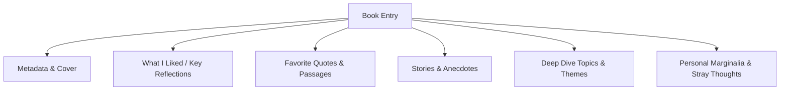

# 📖 Digital Reading Journal — Context & Concept Plan

> **Project Concept**: A tactile, aesthetic digital reading sanctuary designed like a real physical book. A place to log books read, favorite quotes, captivating stories, lessons learned, and spontaneous marginalia — complete with authentic paper textures and smooth page-flip animations.

---

## 1. Project Vision & Philosophy

Most modern book apps (like Goodreads or StoryGraph) feel like spreadsheets with ratings and statistics. This project aims for the opposite: **a slow, reflective, intimate reading journal**.

- **Atmosphere**: Feels like opening a leather-bound or cloth-bound hardcover journal on a mahogany desk by warm lamplight.
- **Purpose**: A personal archive of mental nourishment — capturing not just *what* you read, but *how it made you think*:
  - What resonated with you.
  - Memorable stories, allegories, and parables.
  - Unforgettable quotes and standout passages.
  - Personal reflections, connections to your life, and critique.
- **Simplicity & Permanence**: Lightweight, static, and zero-maintenance. Deployable on **GitHub Pages** or **Cloudflare Pages** for free, with notes stored in clean, editable files (Markdown / JSON).

---

## 2. Key Content Structure (What You Can Capture)

Each book entry in your digital journal can feature modular sections:



### Content Fields per Book:
1. **Book Header & Identity**:
   - Title, Author, Year Published.
   - Cover art (or an aesthetic minimalist book-jacket illustration).
   - Category / Tags (e.g., *Philosophy, Sci-Fi, Psychology, Biographies, Fiction*).
   - Date Read & Your Personal "Vibe" / Rating (e.g., *★ ★ ★ ★ ★* or a 1-sentence impression).

2. **Core Journal Sections**:
   - **"The Core Spark" (What I Liked)**: High-level takeaway of why this book mattered or how it altered your perspective.
   - **"Memorable Quotes"**: Beautifully styled blockquotes with page numbers and why they hit home.
   - **"Stories & Parables"**: Short retellings of anecdotes or case studies from the book that you want to remember forever.
   - **"Themes & Topics"**: Deeper dives into specific concepts, frameworks, or arguments.
   - **"Marginalia & Stray Notes"**: Scribbled-style side notes, questions raised, and ideas sparked for your own life or projects.

---

## 3. UI/UX & Aesthetic Blueprint: "The Living Book"

### 3.1 Visual Styling & Texture
- **Paper Palette**: Warm, creamy off-white book paper (`#FAF7F0` / `#F5F0E6`) with subtle paper grain texture and soft inner-spine drop shadow.
- **Typography**:
  - Headings & Quotes: Classical, elegant serif typography (e.g., *Playfair Display*, *Cinzel*, or *EB Garamond*).
  - Body Text: High-legibility editorial serif (e.g., *Merriweather*, *Lora*, or *Newsreader*).
  - Marginalia / Personal notes: Organic handwritten font (e.g., *Caveat*, *Nanum Pen Script*, or *Reenie Beanie*).
- **Physical Book Details**:
  - Gutter shadow down the center crease between left and right pages.
  - Page numbers at the footer corners (`p. 42`, `p. 43`).
  - Red or gold silk ribbon bookmark hanging from the top edge.
  - Subtle deckled edge effect on the outer page borders.
  - Optional soft dark mode: "Late Night Library" (warm amber glow on deep charcoal/navy desk).

### 3.2 Page-Flip & Interactive Mechanics
- **Tactile Page Turn**:
  - **Desktop**: Realistic 3D dual-page spread (left & right page) with interactive corner curl and page-flip transition using CSS 3D transforms / lightweight flip engine (like `PageFlip` / StPageFlip or smooth custom 3D CSS).
  - **Mobile / Responsive**: Automatically folds into a clean single-page journal with horizontal swipe or tap-to-turn transitions.
- **Navigation Controls**:
  - Arrow keys (`←` / `→`), clickable page edge corners, or bottom navigation bar.
  - **Table of Contents (Index)**: A classic book index page at the front listing all books with chapter-like jump links.
  - **Search & Filter**: Search by title, author, or filter by tag (e.g., *#Philosophy*, *#FavoriteStories*).
  - Optional ambient paper rustle sound effect on page turn (with toggle switch).

---

## 4. Architecture & Technical Design

### Zero-Friction Principles:
- **No Heavy Framework Overhead**: Keeps load times under 1 second, works without complicated build pipelines.
- **Pure Static Architecture**: 100% compatible with free static hosting.

### Recommended Tech Stack Options:

| Stack Option | Pros | Best For |
| :--- | :--- | :--- |
| **Option A: Pure Vanilla (HTML5 + Modern CSS + JS)** | • Zero build step or npm needed<br>• Works right out of the box in any browser<br>• Instant push-to-deploy on GitHub Pages<br>• Extremely easy to customize | Quickest, simplest, most indestructible |
| **Option B: Modern Vite + Vanilla/Tailwind + Markdown Engine** | • Allows writing each book as a standalone `.md` file<br>• Fast dev server (`npm run dev`)<br>• Auto-builds to static `/dist` for Cloudflare/GitHub | If you want to write pure Markdown files for each book |

> **Recommendation**: Start with a lightweight, beautifully crafted single-page or static data-driven setup (`books.json` or markdown parser) that can be opened directly or built cleanly.

---

## 5. Content Management (How You Add Notes)

Adding a new book note should take seconds without touching UI code:

### Structure: Simple JSON or Markdown Entries
Each book entry can look like this:

```json
{
  "id": "atomic-habits",
  "title": "Atomic Habits",
  "author": "James Clear",
  "cover": "assets/covers/atomic-habits.jpg",
  "dateRead": "October 2026",
  "tags": ["Habits", "Psychology", "Productivity"],
  "rating": 5,
  "oneLiner": "You do not rise to the level of your goals. You fall to the level of your systems.",
  "whatILiked": "The emphasis on identity-based habits rather than outcome-based habits...",
  "quotes": [
    {
      "text": "Every action you take is a vote for the type of person you wish to become.",
      "page": "38"
    }
  ],
  "stories": [
    {
      "title": "The British Cycling Renaissance",
      "summary": "How Dave Brailsford used 1% marginal gains to turn a failing team into Olympic champions."
    }
  ],
  "topics": [
    {
      "title": "The 4 Laws of Behavior Change",
      "notes": "Make it obvious, make it attractive, make it easy, make it satisfying."
    }
  ],
  "marginalia": "Apply this to daily evening reading routines—place the physical book on my pillow in the morning."
}
```

---

## 6. Deployment Workflow (GitHub Pages & Cloudflare Pages)

### Deployment Choice 1: GitHub Pages
- **Cost**: 100% Free.
- **Setup**:
  1. Commit code to a GitHub repo (e.g., `username/reading-notes`).
  2. Enable GitHub Pages in Repository Settings -> Pages -> Source: `Deploy from branch (main / root)`.
  3. Live within 60 seconds at `https://<username>.github.io/reading-notes/`.

### Deployment Choice 2: Cloudflare Pages
- **Cost**: 100% Free with unlimited bandwidth and blazing global edge CDN.
- **Setup**:
  1. Connect GitHub repository to Cloudflare Pages dashboard.
  2. Framework Preset: *None* (or *Vite* if using a bundler).
  3. Build Output Directory: `./` (or `dist`).
  4. Automatically rebuilds and deploys upon every `git push`.

---

## 7. Phased Implementation Roadmap

1. **Phase 1: Design System & Core Book Container**
   - Realistic book cover, spine, pages, textures, drop shadows, and typography.
   - Dual-page spread layout for desktop, single-page for mobile.
2. **Phase 2: Page-Flip Animation Engine**
   - 3D transition / flip animation with smooth easing and responsive scaling.
   - Arrow keys, swipe gestures, and corner click triggers.
3. **Phase 3: Content Template & Reader View**
   - Clean page templates for Book Covers, Table of Contents, Reflections, Quotes, Stories, and Marginalia.
4. **Phase 4: Data Engine & Easy Content Updating**
   - Dynamic loading from a structured data file (`data/books.json` or Markdown reader).
   - Filter by tag, search by title, and book index.
5. **Phase 5: Deployment & Polish**
   - Test responsive behaviors, accessibility, and push to GitHub Pages / Cloudflare Pages.
